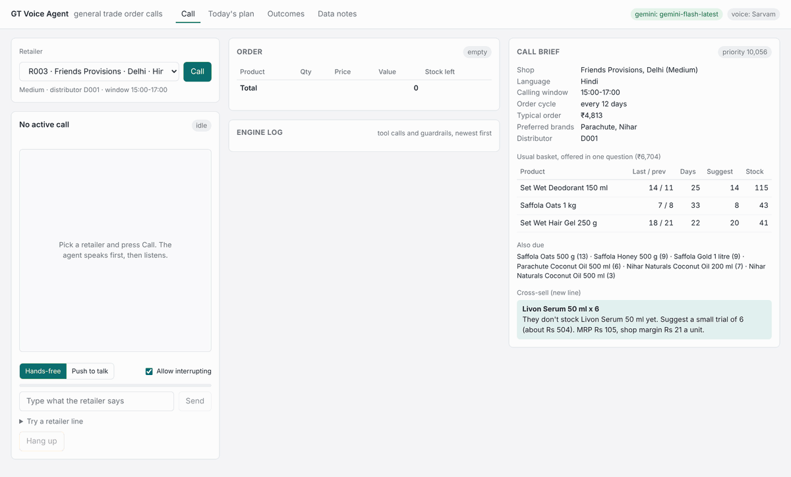

# GT Voice Agent

[](https://github.com/lingesh255/gt-voice/actions/workflows/tests.yml)

An AI telecaller for Marico's general trade channel, built for the Marico x IIT Madras build challenge.

It calls a retailer, checks it's talking to the right shop, offers their usual order as one basket with a total, takes changes by voice in the retailer's language, and books the order only after a clear yes. The order goes out as a record a distributor's system can take; callbacks, complaints, hand-overs and opt-outs are recorded too.

The model only does the talking. Stock, units, prices, the read-back and the confirmation are all checked in Python, and the model can change an order only through tools the engine can refuse.



- [Solution presentation](docs/solution-presentation.pdf) (5 slides) and [scalability approach](docs/scalability-approach.pdf) (3 slides), with PowerPoint versions in `docs/`
- [Design notes](docs/design.md): business rules, guardrails, the order record, and what the data check found

## Quick start

You need Python 3.10+ and Chrome or Edge.

```bash
python -m venv .venv
source .venv/bin/activate        # Windows: .venv\Scripts\Activate.ps1
pip install -r requirements.txt
cp .env.example .env             # Windows: copy .env.example .env
```

Add your keys to `.env`, then check them and start the app:

```bash
python main.py --check
python main.py
```

Open http://127.0.0.1:8000.

| Key | Needed for | Where to get it |
|---|---|---|
| `GEMINI_API_KEY` | the agent (required) | aistudio.google.com/apikey; the free tier is fine for a demo |
| `SARVAM_API_KEY` | Indian-language speech (recommended) | dashboard.sarvam.ai; new accounts get free credit |

Without a Sarvam key the app uses the browser's own speech recognition and voice. That works, but Sarvam is much better with Hindi-English mixing and regional accents. Any OpenAI-compatible model can stand in for Gemini; see `.env.example`.

`--check` makes one real request to each service and tells you what's wrong if something is:

```
Checking setup...
  [ok  ] Data    100 retailers, 20 SKUs, 1000 purchase lines, as of 20 Nov 2026
  [ok  ] Model   gemini-flash-latest answered in 640 ms
  [FAIL] Speech  Sarvam rejected the API key. Check SARVAM_API_KEY in .env.
```

## Demo in two minutes

1. Call **R001**. It's refused: the shop from the brief's sample call is on the do-not-call list.
2. Call **R003** and say yes when asked if it's Friends Provisions. The agent offers the usual basket with a total.
3. Say "haan, yahi bhej do". It offers one add-on (Livon Serum 50 ml). Take it or not, then confirm.
4. Open **Outcomes** to see the order record, how the basket did, and the call log.
5. Call **R043** and ask for Saffola Gold 1 litre. It's out of stock at that distributor, so the agent offers an alternative. Try "10 boxes" and "switch to English" too.

You can talk (hands-free, or hold the space bar), type, or click a ready line under **Try a retailer line**. That's the quickest way to run the surprise scenarios. Each agent reply shows how long it took; hover to see the time split between speech recognition, model and voice.

Other retailers worth calling: R011 (Tamil, its regular 200 ml order is larger than the stock), R008 (Marathi, the serum it buys is out of stock and the 50 ml is offered), R064 (Parachute buyer, Saffola Gold top-up as the add-on).

## Tests

```bash
pip install -r requirements-dev.txt
pytest -q
ruff check .
```

The tests run offline. They cover every row of `Call_Scenarios`, the six surprise scenarios, the usual basket, quantity and unit parsing in Hindi, English and Tamil, stock holds across two calls, and the API. The Gemini, OpenAI and Sarvam request formats are checked against mocked HTTP.

Conversation evals run the real model against a second model playing the shopkeeper, then check what was recorded:

```bash
python -m evals.run                 # all 26 cases
python -m evals.run --tag surprise  # the six surprise scenarios
python -m evals.run --tag basket    # how often the usual basket is taken with one yes
python -m evals.run --judge         # also scores naturalness, language, respect, accuracy
```

Results go to `evals/report.md`, with transcripts and tool calls in `evals/out/`. On the Gemini free tier a full run is slow because of rate limits; the runner waits and retries.

## Deploying

```bash
docker build -t gt-voice .
docker run -p 8000:8000 --env-file .env gt-voice
```

The container listens on `$PORT` (default 8000), runs as a non-root user and has a health check on `/healthz`. Browsers only allow the microphone on `localhost` or HTTPS, so put a hosted copy behind HTTPS.

Each turn is logged on one line with timings:

```
17:42:10 call 68e1d032 R003 turn 4: stt 410 ms, model 1630 ms, tts 520 ms, order read_back Rs 6704
```

## Troubleshooting

- **PowerShell won't run `Activate.ps1`.** Run `Set-ExecutionPolicy -Scope Process Bypass` in that window first.
- **"The model provider rejected the API key."** The key in `.env` is wrong or has spaces around it. `python main.py --check` confirms the fix.
- **"Rate limit or quota is used up."** The free tier allows a limited number of requests a minute. Wait a minute, or use a paid key for long eval runs.
- **Microphone blocked.** The call carries on by typing. Allow the mic from the lock icon in the address bar and call again.
- **No voice from the browser.** Some systems have no Hindi or Tamil voice installed. Add a Sarvam key, or install the language's voice in the OS settings.

## Project layout

```
app/
  planner.py     who to call, the usual basket, quantities, cross-sell pick
  session.py     one call: the tools the agent can use, guardrails, records
  catalog.py     product search from what the retailer said
  quantities.py  numbers, units, boxes, vague amounts, yes/no in several languages
  inventory.py   distributor stock with per-call holds
  order.py       order state: draft, read back, confirmed
  agent.py       model loop: tools in, spoken line out
  prompts.py     the agent's instructions
  llm.py         Gemini (native API) and OpenAI-compatible clients
  speech.py      Sarvam speech-to-text and text-to-speech
  server.py      FastAPI app
  checks.py      setup check behind --check
  data.py, audit.py, languages.py, oms.py, outcomes.py, errors.py, config.py, tools.py
web/             softphone and ops console (plain JS, no build step)
evals/           conversation eval cases and runner
tests/           offline tests
docs/            slides, design notes, screenshots
```

## Known limits

- Turns go over HTTP, so a reply takes a couple of seconds. In production, audio would stream both ways over telephony (Exotel or Plivo into Pipecat or LiveKit) to get under a second.
- Sarvam has no Assamese voice yet. Assamese replies use the Bengali voice, which shares the script; recognition does support Assamese.
- Stock comes from the workbook snapshot. Holds live in memory and reset on restart; orders, tasks and opt-outs are kept in `runs/`.
- Prices are the distributor billing prices from the workbook. There is no scheme or discount logic.
